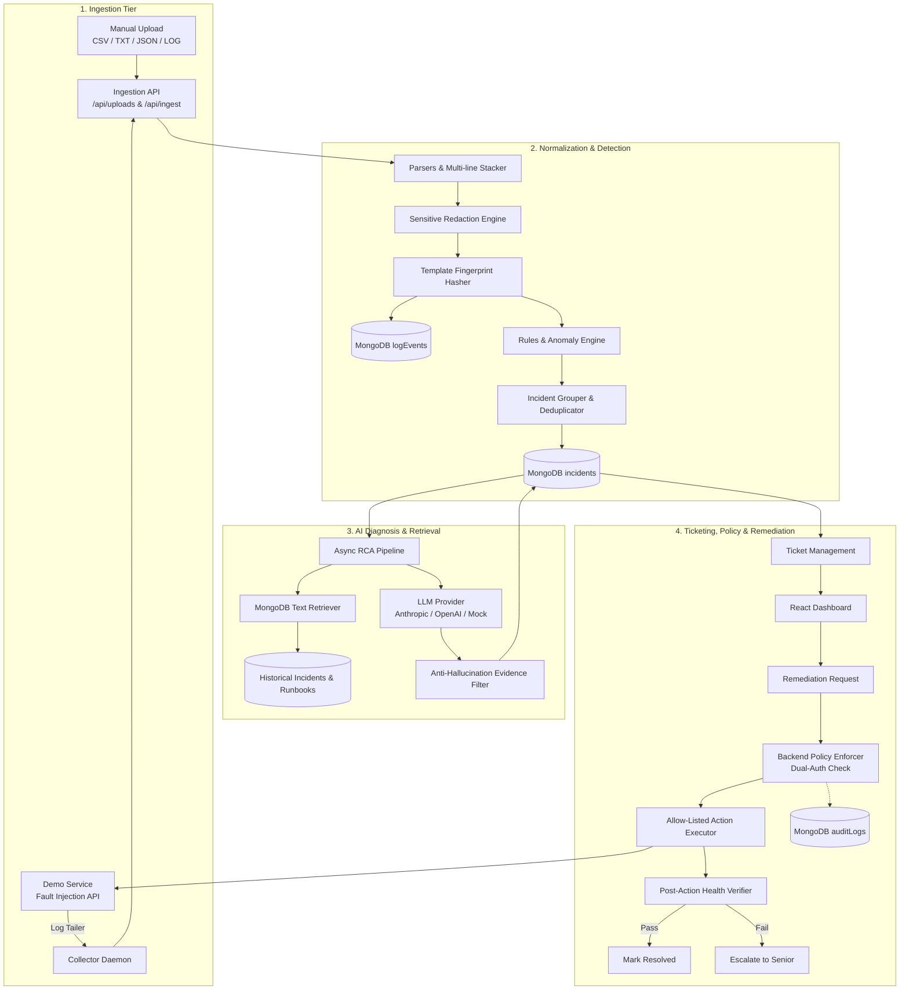

# AI Root Cause Analysis & Intelligent Ticket Resolution Copilot

[](https://www.python.org/downloads/)
[](https://fastapi.tiangolo.com/)
[](https://reactjs.org/)
[](https://www.typescriptlang.org/)
[](https://www.mongodb.com/)
[](https://opensource.org/licenses/MIT)

An enterprise decision-support copilot designed to empower IT, DevOps, and SRE teams in investigating, diagnosing, and safely resolving complex distributed application incidents.

---

## 🌟 Key Capabilities

- **Unified Multi-Format Ingestion**: Ingests logs from manual file uploads (CSV, TXT, LOG, JSON, JSON Lines) and live microservice log collectors using a single normalized schema.
- **Sensitive Data Redaction**: Automatic masking of passwords, bearer tokens, API keys, emails, and card numbers with persistent audit indicators.
- **Noise Suppression & Deduplication**: Real-time pattern detection, severity threshold windowing, and z-score anomaly detection with fingerprint-based deduplication to eliminate alert fatigue.
- **Grounded AI Root Cause Analysis**: Generates structured Pydantic-validated root cause hypotheses, separating observed facts from AI inferences, with a strict anti-hallucination citation filter.
- **Historical Incident & Runbook Retrieval**: Text-search indexing across past incidents and approved runbooks for instant institutional knowledge transfer.
- **Ticket Lifecycle & Allow-Listed Remediation**: Persistent ticket tracking (P1–P4) with strictly allow-listed remediation actions (`restart_demo_service`, `clear_demo_cache`, `rollback_demo_config`). **Zero arbitrary shell execution**.
- **Backend Policy Dual-Authorization**: Independent backend enforcement requiring senior approval for high-risk actions. Self-approval is strictly forbidden.
- **Recovery Health Check Verification**: Actions only put incidents into a `verifying` state; incidents and tickets are marked `resolved` only after post-action health checks pass.
- **Append-Only Audit Trail**: Immutable logging of all state transitions, user logins, approvals, and executed remediation actions.
- **Comprehensive Benchmark Suite**: Labeled scenario evaluation generator producing precision, recall, top-1/top-3 RCA accuracy, and MTTR reduction metrics.

---

## 🏗️ Architecture



---

## 👥 Seeded User Accounts & Roles

The system is pre-seeded with three accounts representing standard role hierarchies:

| Username | Password | Role | Responsibilities |
| :--- | :--- | :--- | :--- |
| `support` | `supportpassword123` | `support_engineer` (L1/L2) | Upload logs, view incidents/evidence, request remediation, update tickets. |
| `approver` | `approverpassword123` | `approver` (Senior) | All support capabilities + review/approve/reject protected actions, handle escalations. |
| `admin` | `adminpassword123` | `admin` | Full system access: manage users, log sources, detection rules, runbooks, allow-lists. |

*Credentials can be configured via environment variables in `.env`.*

---

## 🚀 Quickstart with Docker Compose

To start the entire multi-service stack with a single command:

```bash
docker compose up -d --build
```

### Services Exposed
- **Web UI Dashboard**: [http://localhost:3000](http://localhost:3000)
- **Backend API & Swagger Docs**: [http://localhost:8000/docs](http://localhost:8000/docs)
- **Demo Application & Fault Injection**: [http://localhost:8001/docs](http://localhost:8001/docs)
- **MongoDB Database**: `mongodb://localhost:27017`

---

## 🎮 Interactive End-to-End Demo Script

Follow this walkthrough to witness the complete autonomous pipeline from fault injection to recovery verification:

### 1. Log in to the Dashboard
Navigate to [http://localhost:3000](http://localhost:3000). Click the **Quick Role Selector** button for **Support Engineer** (`support`) and log in.

### 2. Trigger an Incident via Fault Injection
In a separate terminal, trigger a simulated database pool saturation on the demo app:
```bash
curl -X POST http://localhost:8001/faults/db_connection_timeout
```
Verify the demo app health is degraded:
```bash
curl http://localhost:8001/health
# Returns HTTP 503 {"status": "degraded", "fault": "db_connection_timeout"}
```

### 3. Observe Real-Time Ingestion & Incident Correlation
- The `collector` daemon tails the demo app log file and forwards events to `/api/ingest`.
- The rule engine matches the `db_pool_timeout_rule`, groups events by service + fingerprint, and creates an Incident.
- In the Web UI, navigate to **Incidents**. You will see a new **CRITICAL** incident for `order-service`.

### 4. Review Grounded AI Root Cause Analysis
- Click into the incident.
- Review the **Probable Causes** hypothesis card:
  - Confidence: `High (0.92)`
  - Grounded evidence excerpts linking directly to the database timeout logs.
  - Strict separation of **Observed Facts** from **AI Inferences**.
  - Recommended diagnostic checks and linked runbooks (`rb-db-recovery`).

### 5. Request Remediation (Support Engineer)
- Click **Request Remediation Action**.
- Select `restart_demo_service`.
- Notice the status updates to **Awaiting Approval**.

### 6. Senior Dual-Authorization Approval
- Log out and log in as `approver` (`approverpassword123`).
- Go to the **Approval Queue**. Review the pending request for `order-service`.
- Click **Approve**. (Note: the backend strictly prevents requesters from approving their own actions).

### 7. Execution & Automatic Recovery Verification
- Click **Execute Approved Action**.
- The backend executes the allow-listed code path, calling `POST http://demo-app:8001/admin/restart`.
- The incident moves to `verifying` status.
- The recovery verification loop checks `GET http://demo-app:8001/health`.
- Once the health check returns `200 OK`, the incident and linked ticket are automatically marked **Resolved**!

### 8. Inspect Immutable Audit History
- Navigate to **Audit Trail** in the top navigation.
- Verify the complete chain of events: action request, approval decision, action execution, and recovery resolution.

---

## 🧪 Testing & Evaluation

### Backend Unit & Integration Tests (27 Tests)
```bash
pytest backend/tests/ -v
```
Covers:
- Multi-format parsers (CSV, JSON, plain text stack traces)
- Sensitive data redaction & fingerprint stability
- Rule matching, grouping, deduplication & repeat reopen
- Provider-independent LLM service & anti-hallucination validation
- Dual-role authorization bypass rejection & self-approval prevention
- Recovery health check verification & append-only audit trail

### Frontend Unit Tests
```bash
cd frontend && npm test
```

### Benchmark Evaluation Suite
Run the 10-scenario evaluation benchmark suite:
```bash
python eval/evaluate.py
```
Outputs:
- **Detection Precision**: `100.0%`
- **Detection Recall**: `100.0%`
- **False Positive Rate**: `0.0%`
- **RCA Top-1 Accuracy**: `100.0%`
- **Evidence Relevance**: `88.9%`
- **Automated MTTR**: `4.59s` (vs `1,833.3s` manual baseline)
- Reports: `eval/eval_results.json` & `eval/eval_report.md`

### Automated End-to-End Scenario Script
```bash
python tests/e2e_scenario.py
```

---

## 📁 Repository Layout

```
├── backend/
│   ├── app/
│   │   ├── api/          # REST route handlers (auth, uploads, logs, incidents, tickets, remediation, audit)
│   │   ├── core/         # Config, database manager, security, seeder
│   │   ├── models/       # Pydantic v2 schemas
│   │   ├── repositories/ # MongoDB data access repositories
│   │   ├── services/     # Ingestion, parsing, normalization, redaction, detection, grouping, RCA, policy
│   │   └── workflows/    # Orchestrated pipeline hooks
│   ├── tests/            # Test suite for Phases 1-5
│   └── Dockerfile
├── frontend/
│   ├── src/
│   │   ├── api/          # Type-safe Axios client
│   │   ├── components/   # UI elements (Navbar, Modals, StatusBadges)
│   │   ├── pages/        # Dashboard, UploadLogs, LogExplorer, Incidents, Detail, Tickets, Approvals, Audit
│   │   └── types/        # TypeScript interfaces
│   └── Dockerfile
├── demo-app/             # Microservice emitting logs with triggerable faults & admin endpoints
├── collector/            # Python log tailer forwarding events to /api/ingest
├── eval/                 # Synthetic scenario generator and benchmark runner
├── seed/                 # Standalone database seeder script
├── docs/                 # ARCHITECTURE.md, DECISIONS.md, PROGRESS.md, API.md, EVALUATION.md, LIMITATIONS.md
├── docker-compose.yml    # Full-stack orchestration
├── Makefile              # Build, test, and run automation
└── .env.example          # Environment variable template
```

---

## 📄 License
This project is licensed under the MIT License.
