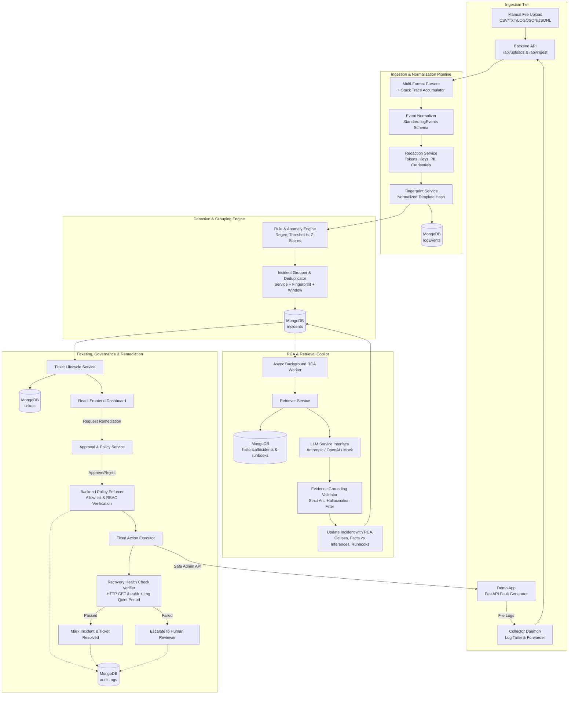

# AI Root Cause Analysis & Intelligent Ticket Resolution Copilot
## Architecture Design Document

### 1. System Overview
The **AI Root Cause Analysis & Intelligent Ticket Resolution Copilot** is an enterprise-grade decision support platform designed to assist IT/DevOps/SRE teams during production incidents. It provides an end-to-end operational pipeline:
1. **Multi-Source Ingestion**: Ingests logs through manual multi-format upload (CSV, TXT, LOG, JSON, JSON Lines) and live streaming collectors (tailing microservice container logs).
2. **Deterministic Processing Pipeline**: Ingestion -> Format Parsing & Multi-line Stacking -> Schema Normalization -> Sensitive Data Redaction -> Fingerprinting -> MongoDB persistence.
3. **Detection, Grouping & Deduplication**: Real-time pattern detection rules, severity-window thresholds, and rolling z-score error-rate spike anomaly detection. Correlates log events into cohesive Incidents using fingerprint, service, and temporal window grouping to eliminate alert fatigue.
4. **Historical Retrieval & Grounded AI RCA**: Retrieves top-k similar historical resolved incidents and approved runbooks via MongoDB text search indices. Feeds context into an isolated LLM provider interface (Anthropic, OpenAI-compatible, Mock) enforcing strict Pydantic JSON schemas with citation validation, separating observed facts from AI hypotheses.
5. **Ticketing & Dual-Gated Remediation**: Auto-creates/links ticket records across P1-P4 priority tiers. Enforces allow-listed remediation actions (e.g. `restart_demo_service`, `clear_demo_cache`, `rollback_demo_config`) protected by backend RBAC authorization and mandatory post-action recovery verification checks before resolution.
6. **Immutable Audit & Evaluation**: Append-only audit logging across all state transitions, approvals, and executions. Comprehensive offline and online evaluation framework reporting precision, recall, false-positive rate, RCA top-k accuracy, and MTTR.

---

### 2. High-Level Architecture Diagram



---

### 3. Repository Architecture & Layout

```
.
├── backend/
│   ├── app/
│   │   ├── api/              # FastAPI router endpoints (auth, uploads, ingest, incidents, tickets, remediation, audit, admin)
│   │   ├── core/             # Configuration, security, database connection, logging, exceptions
│   │   ├── models/           # Pydantic v2 schemas and domain models
│   │   ├── repositories/     # MongoDB data access layer (async Motor)
│   │   ├── services/         # Pure business logic services (ingestion, parsing, normalization, redaction, detection, grouping, rca, llm, retrieval, tickets, remediation, policy, health_checks, audit)
│   │   └── workflows/        # Orchestrated pipelines (incident RCA pipeline, remediation-verification workflow)
│   ├── tests/                # Unit and integration tests (pytest + httpx)
│   ├── Dockerfile
│   └── requirements.txt
├── frontend/
│   ├── src/
│   │   ├── api/              # Axios / Fetch type-safe client
│   │   ├── components/       # Reusable UI components (Navbar, Modal, Tables, Badges, Timeline, CodeView)
│   │   ├── hooks/            # TanStack Query & custom state hooks
│   │   ├── pages/            # View pages (Login, Dashboard, Uploads, Logs, Incidents, IncidentDetail, Tickets, Approvals, Audit, Admin)
│   │   ├── types/            # TypeScript interfaces aligned with backend Pydantic models
│   │   ├── App.tsx
│   │   └── main.tsx
│   ├── package.json
│   ├── Dockerfile
│   └── vite.config.ts
├── demo-app/                 # Realistic microservice emitting structured & plain logs with fault injection
│   ├── main.py
│   ├── Dockerfile
│   └── requirements.txt
├── collector/                # Python lightweight log tailer forwarding events to /api/ingest
│   ├── tailer.py
│   ├── Dockerfile
│   └── requirements.txt
├── eval/                     # Evaluation benchmark suite
│   ├── scenarios/            # 8+ synthetic labeled incident scenarios + negative scenarios
│   ├── generator.py          # Scenario log generator
│   └── evaluate.py           # Evaluation runner outputting JSON & Markdown reports
├── seed/                     # Database seed data (users, rules, runbooks, remediation actions, historical incidents)
│   ├── seed_data.py
│   └── data/
├── docs/                     # Documentation suite
│   ├── ARCHITECTURE.md
│   ├── DECISIONS.md
│   ├── PROGRESS.md
│   ├── API.md
│   ├── EVALUATION.md
│   └── LIMITATIONS.md
├── docker-compose.yml
├── Makefile
├── .env.example
└── README.md
```

---

### 4. Role-Based Access Control (RBAC) Matrix

| Resource / Action | Support Engineer (L1/L2) | Senior Engineer (Approver) | Administrator |
|---|:---:|:---:|:---:|
| Upload Logs & View Logs | Yes | Yes | Yes |
| View Incidents & RCA Hypotheses | Yes | Yes | Yes |
| Provide RCA Feedback (Useful / Not) | Yes | Yes | Yes |
| Update Tickets & Add Comments | Yes | Yes | Yes |
| Request Remediation Action | Yes | Yes | Yes |
| Approve / Reject Remediation Action | No | Yes (cannot self-approve) | Yes |
| Execute Remediation Action | Backend Policy | Backend Policy | Backend Policy |
| Manage Users, Log Sources & Settings | No | No | Yes |
| Manage Rules, Runbooks & Allow-list | No | No | Yes |
| View Audit Trail | Read-only | Read-only | Full Access |

---

### 5. Normalized Event Schema (`logEvents`)

```json
{
  "_id": "ObjectId",
  "timestamp": "2026-10-13T00:10:00.000Z",
  "ingestedAt": "2026-10-13T00:10:02.120Z",
  "service": "order-service",
  "severity": "ERROR",
  "message": "Connection to database replica timed out after 5000ms",
  "source": {
    "type": "live",
    "sourceId": "demo-app-1",
    "fileName": null,
    "uploadId": null
  },
  "traceId": "trace-9831a2",
  "requestId": "req-49120",
  "hostId": "demo-node-01",
  "attributes": {
    "pool_size": 10,
    "active_connections": 10
  },
  "parseStatus": "ok",
  "parseError": null,
  "fingerprint": "e3b0c44298fc1c149afbf4c8996fb92427ae41e4649b934ca495991b7852b855",
  "redacted": true
}
```

---

### 6. Safety & Security Guarantees
1. **Zero Shell Execution**: No arbitrary shell command or dynamic string evaluation exists anywhere in the codebase. Every remediation action executes via a strictly compiled function mapped to fixed internal HTTP endpoints on the demo app.
2. **Backend Dual-Authorization Guard**: Approvals are validated strictly on the backend prior to execution. Self-approvals are blocked for high-risk actions.
3. **Anti-Hallucination Evidence Grounding**: Every log event cited in an AI hypothesis must have its excerpt verifiable against actual ingested events. Unmatched citations are automatically pruned or flagged.
4. **Verification-Obligated Incident Resolution**: No action directly marks an incident resolved. The incident transitions to `verifying` where active health checks (`/health` + quiet log checks) must pass before `resolved` is attained.
